# POOProject : moteur masses-ressorts en C++

Un moteur physique 2D de particules reliees par des ressorts, ecrit en C++17
pour le projet de POO (Phelma, S9 SEI). Treize scenes interactives : on attrape
les particules a la souris, on epingle, on change d'integrateur en direct.

<p align="center">
  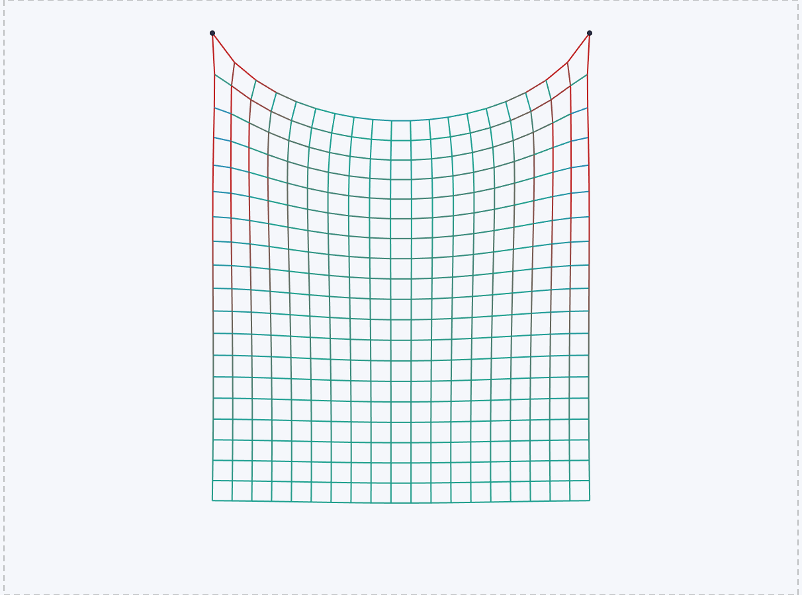
  <br><sub>Tissu : 400 particules, 1 482 ressorts. Les ressorts tendus rougissent.</sub>
</p>

## Les scenes

<table>
  <tr>
    <td align="center">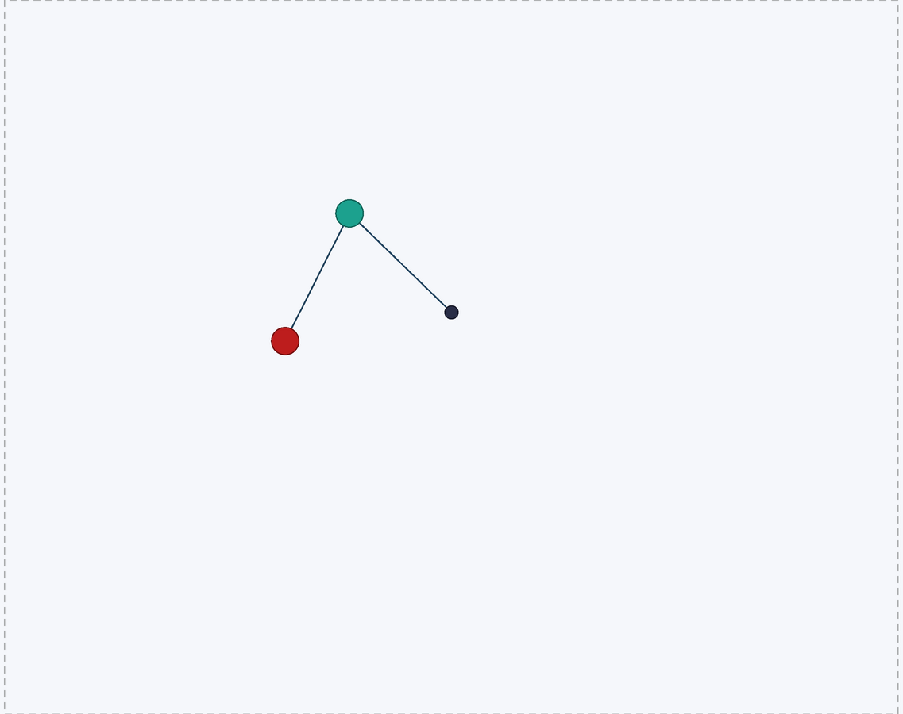<br><sub>Double pendule</sub></td>
    <td align="center">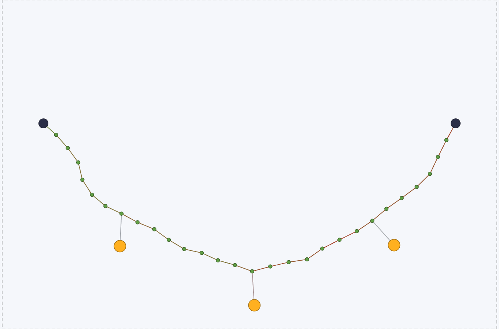<br><sub>Pont de corde</sub></td>
    <td align="center">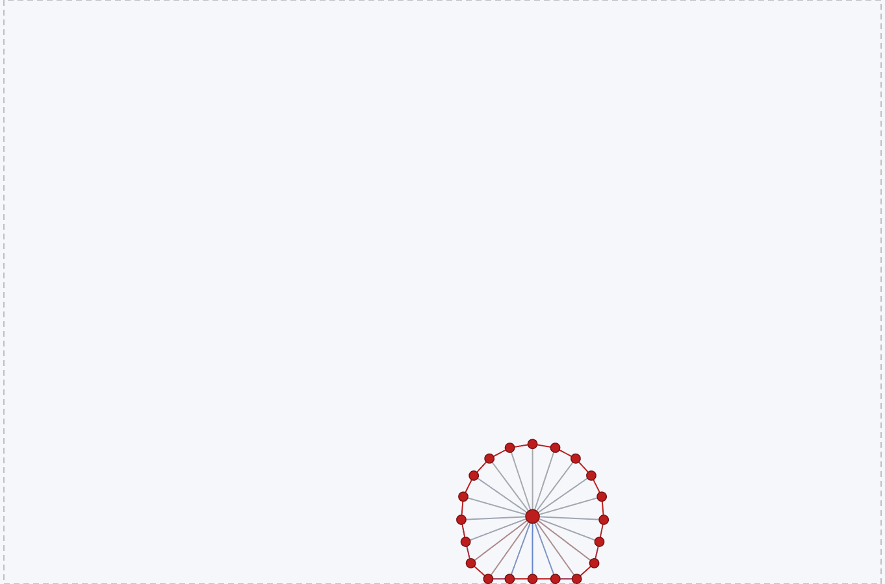<br><sub>Blob</sub></td>
  </tr>
  <tr>
    <td align="center">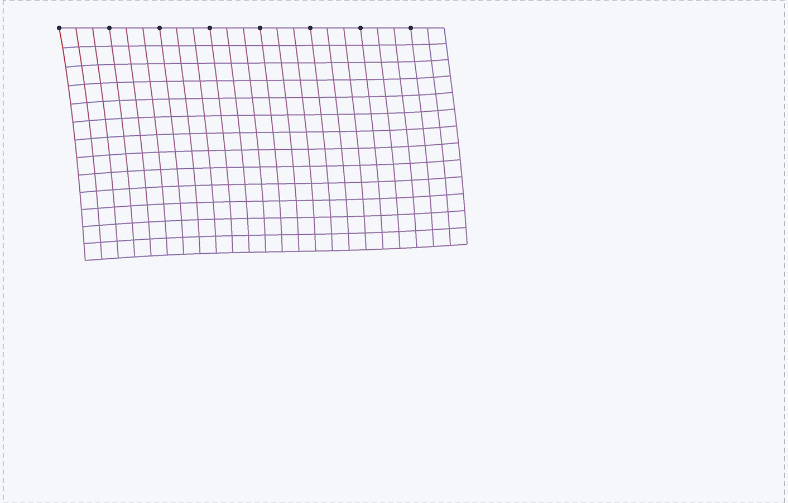<br><sub>Rideau au vent</sub></td>
    <td align="center">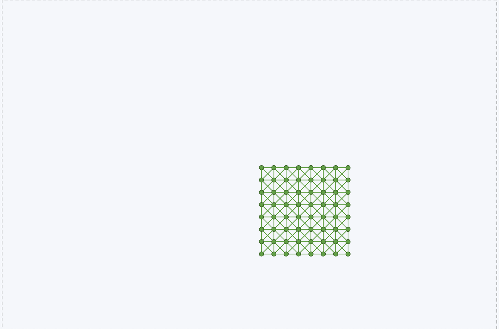<br><sub>Gelee</sub></td>
    <td align="center">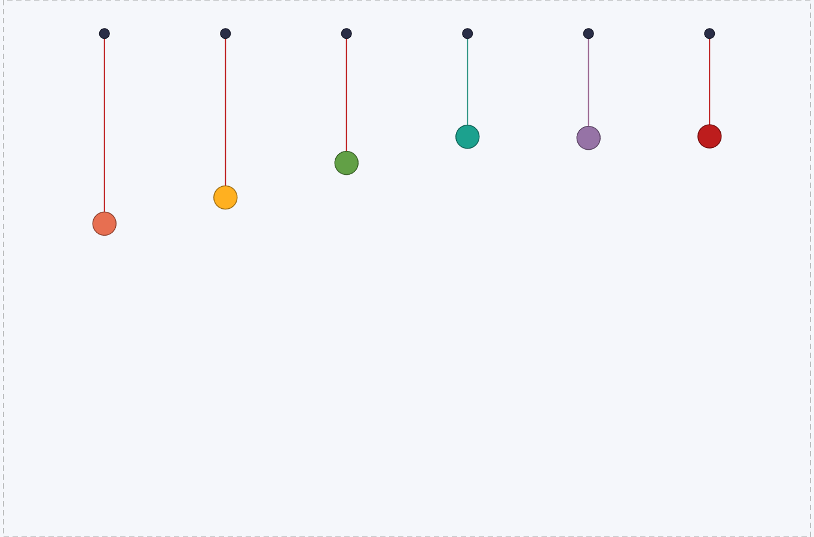<br><sub>Oscillateurs</sub></td>
  </tr>
  <tr>
    <td align="center">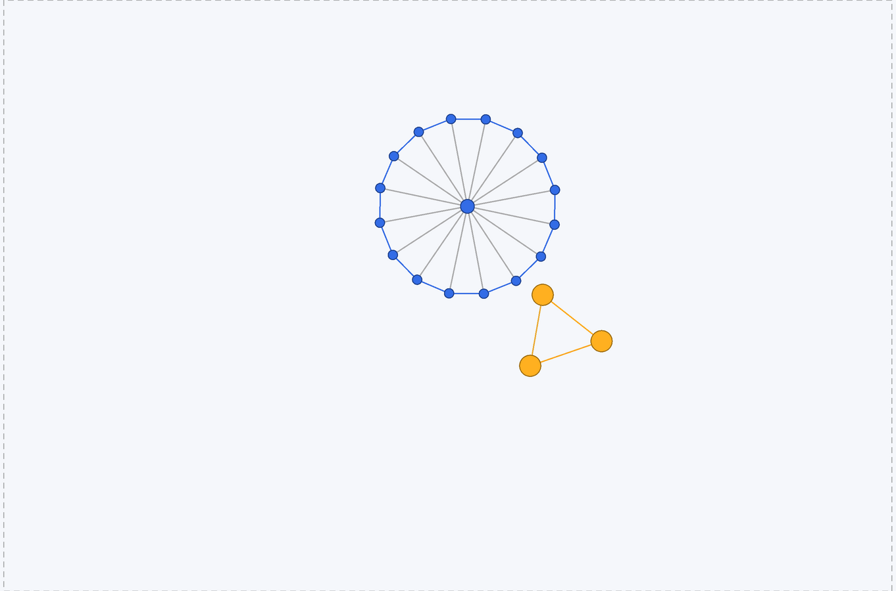<br><sub>Apesanteur</sub></td>
    <td align="center">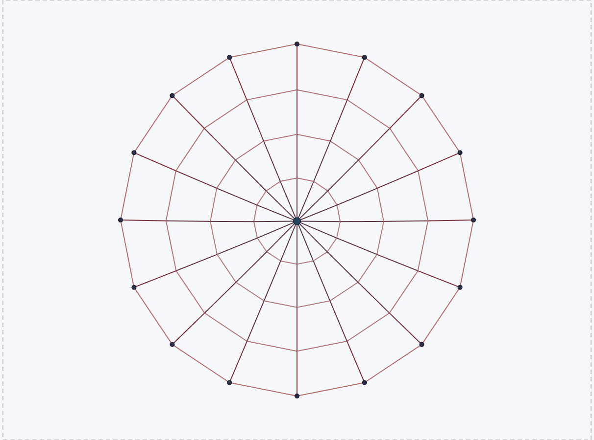<br><sub>Toile d'araignee</sub></td>
    <td align="center">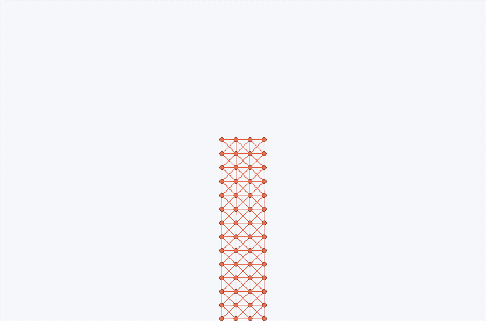<br><sub>Tour en gelee</sub></td>
  </tr>
</table>

## Architecture

La physique ne connait pas SFML : elle dessine a travers l'interface abstraite
`Renderer`, que seul `render/` implemente.

<p align="center">
  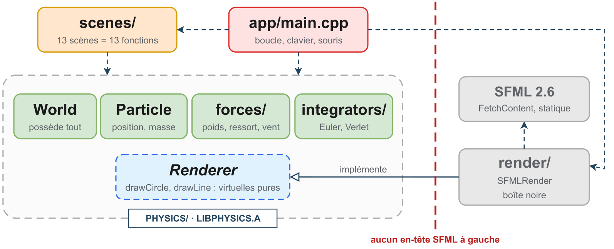
</p>

Les classes : `Particle` et `Spring` heritent virtuellement d'`Entity`
(heritage en diamant via `Drawable` et `Force`), les forces et les
integrateurs sont choisis par liaison dynamique, et `World` possede tout.

<p align="center">
  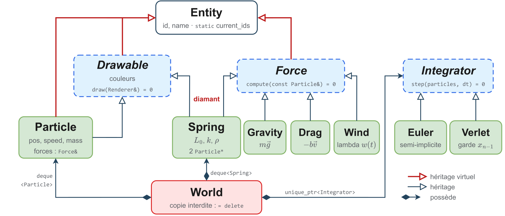
</p>

## Usage

Cloning the repo:
```sh
git clone git@github.com:Audr1c/POOProject.git
cd POOProject
```

Installing dependancies:
```sh
apt-get install libudev-dev #SFML Rendering
```


Building
```sh
cmake -S . -B build
cd build
make poop # ninja poop
./poop
```


## Scenes et commandes

`./poop` affiche la liste des scenes dans la console. Dans la fenetre :

| Touche | Action |
| --- | --- |
| `1` ... `9`, `0` | scenes 1 a 10 |
| fleches gauche / droite | scene precedente / suivante (scenes 11 a 13) |
| `R` | recommencer la scene |
| `I` | changer d'integrateur (Euler / Verlet) en direct |
| `Espace` / `N` | pause / un pas de simulation en pause |
| clic gauche glisse | attraper une particule, la lancer en relachant |
| clic droit | epingler / liberer une particule |
| `Echap` | quitter |

Scenes : pendule, double pendule, corde, pont de corde, tissu 20 x 20, blob,
rideau au vent (extension J4 : vent variable donne par une lambda), gelee,
oscillateurs, pluie de balles, apesanteur, toile d'araignee, tour en gelee.
Les scenes sont dans `scenes/scenes.cpp` : une scene = un nom, une taille et
une fonction qui remplit le monde. En ajouter une = ecrire une fonction et
l'ajouter a `allScenes()`.

Test sans affichage (chaque scene 10 s avec les deux integrateurs) :
```sh
cmake --build build --target scenes_test
./build/scenes_test
```

## Presentation

Le diaporama (beamer) est dans `assets/presentation/` :
```sh
cd assets/presentation
make            # liste les commandes
make all        # tout refaire : schemas, readme, energie, captures, puis les deux PDF
make pdf        # build/main.pdf
make fiche      # build/main-fiche.pdf, fiche d'orateur a imprimer
make captures   # regenere les captures des scenes (cible CMake capture)
make energie    # regenere les courbes d'energie Euler / Verlet (cible energie)
make schemas    # exporte schemas/*.drawio en PDF (draw.io en ligne de commande)
make readme     # PNG des schemas affiches dans ce README (assets/readme/)
make clean      # supprime les fichiers de compilation LaTeX
```

`make all` enchaine les etapes dans l'ordre (figures d'abord, puis les PDF) et
force latexmk a recompiler pour prendre en compte les nouvelles figures. Il
faut avoir compile le projet une fois (`cmake -S . -B build`) : les captures et
les courbes d'energie lancent les cibles CMake `capture` et `energie`.
Un schema n'est reexporte que si son `.drawio` est plus recent que son PDF
(`make -B schemas` pour tout reexporter).

Outils necessaires :

| Outil | Pour | Remarque |
| --- | --- | --- |
| `latexmk` + pdfLaTeX (TeX Live, MiKTeX) | `pdf`, `fiche` | |
| draw.io desktop (`drawio`) | `schemas` | sinon `make schemas DRAWIO="..."` |
| ImageMagick (`magick`) | `captures` | optionnel : sans lui, capture directe en 1600x900, traits moins lisses |

Le Makefile marche sous Linux, dans Git Bash et dans PowerShell. Sous Windows,
il utilise le `sh` de Git for Windows (ou de MSYS2 dans `C:/msys64`) et lance
les programmes avec le dossier du compilateur en tete du `PATH`, pour ne pas
charger la `libstdc++` d'un autre MinGW. Sous Linux sans ecran :
`make captures RUN="xvfb-run -a"`.
